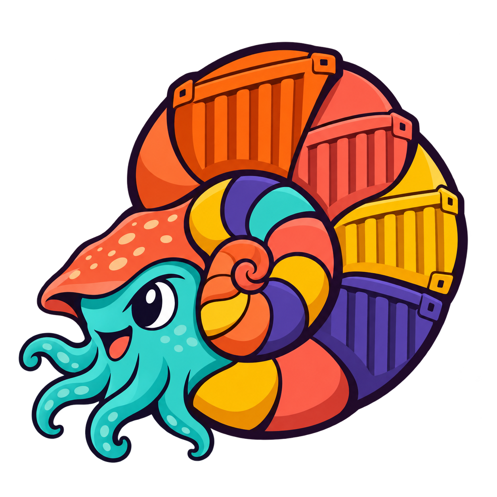

<h1>
  
  
</h1>

Nautilus is a Linux container runtime written in Rust. It implements the Kubernetes Container Runtime Interface (CRI v1) and runs both OCI containers and WebAssembly commands. Kubelet and the bundled CLI use the same Unix socket, so you can try either runtime on a single machine before using it with a cluster.

## What you can run

| Workload | Runtime handler | Input |
| --- | --- | --- |
| Linux container | `runc` (default) | An OCI image from a registry. Nautilus pulls and caches the layers and runs the container with libcontainer. |
| WebAssembly command | `wasi` or `wasm` | A local WASI Preview 1 module exporting `_start`. Wasmtime runs it inside the daemon. |

OCI containers support CNI pod networking, host port mappings, resource limits, logs and exec. You can also load a Wasm policy to allow or deny pod creation, container creation or container start. The [example policy](examples/policy-deny-label) rejects workloads carrying the `nautilus.policy/deny` label.

## Quick start

### Install from source

Use a Linux machine with systemd and a Rust toolchain with Cargo. The following commands install the dependencies on Debian or Ubuntu and build Nautilus from source.

```sh
sudo apt-get update
sudo apt-get install -y git build-essential pkg-config protobuf-compiler libseccomp-dev libsystemd-dev runc iproute2 iptables containernetworking-plugins

git clone https://github.com/nautilus-runtime/nautilus.git
cd nautilus
make install-service
```

This installs `nautilus`, the CLI, and `nautilusd`, the daemon. It also installs the systemd unit and a [default configuration](nautilus.toml) at `/etc/nautilus/config.toml`. Reinstalling preserves your existing configuration.

Before starting the service, check the paths in that file. Set `runtime.runc.path` to the output of `command -v runc`. Set `network.cni_bin_dir` to the directory containing the `bridge`, `loopback` and `host-local` plugins. The default is `/opt/cni/bin`. Debian packages commonly install them under `/usr/lib/cni`; you can locate them with `dpkg -L containernetworking-plugins`.

```sh
sudo systemctl start nautilusd
sudo nautilus version
```

### Run your first container

```sh
sudo nautilus run --rm busybox:1.36 echo 'Hello from Nautilus'
```

Nautilus pulls the image on first use and prints the container ID and its output. With `--rm`, the CLI waits for the command to finish and removes both the container and the sandbox it created. The image stays cached for the next run.

The CLI starts containers in the background by default. This example starts a container named `demo`, reads its logs and runs a second command inside it.

```sh
sudo nautilus run --name demo busybox:1.36 sh -c 'while true; do echo tick; sleep 2; done'
sudo nautilus ps
sudo nautilus logs --tail 5 demo
sudo nautilus exec demo uname -m
sudo nautilus stop demo
sudo nautilus rm demo
```

### Run a WebAssembly command

If you have a WASI Preview 1 command compiled as `hello.wasm`, run it from the directory containing the module.

```sh
sudo nautilus run --rm --runtime wasi "file://$PWD/hello.wasm"
```

The daemon reads the module from its local filesystem. WASI stdout and stderr go to the daemon log, which you can read with `sudo journalctl -u nautilusd`.

## Use CRI tools

The default CRI endpoint is `unix:///run/nautilus/nautilus.sock`. With `crictl` installed, you can list the pod sandboxes on the same daemon.

```sh
sudo crictl --runtime-endpoint unix:///run/nautilus/nautilus.sock pods
```

For the Nautilus CLI, use the global `--socket` option or the `NAUTILUS_SOCKET` environment variable to select a different socket.

## Development

Run the Rust test suite on a Linux test machine with permission to create namespaces and network access to pull test images.

```sh
cargo test --locked --target "$(uname -m)-unknown-linux-gnu"
```

The published CRI baseline for `critest` v1.31.1 is 96 passed, 0 failed and 17 skipped. See the [conformance results](docs/CRITEST_RESULTS.md), [architecture guide](docs/ARCHITECTURE.md) and [roadmap](docs/DEVELOPMENT_ROADMAP.md) for details.

Contributions are welcome. To report a bug, include the output of `nautilus version`, the runtime handler and a minimal command that reproduces the behavior. [Open an issue](https://github.com/nautilus-runtime/nautilus/issues).

## License

Nautilus is licensed under the [Apache License 2.0](LICENSE).
